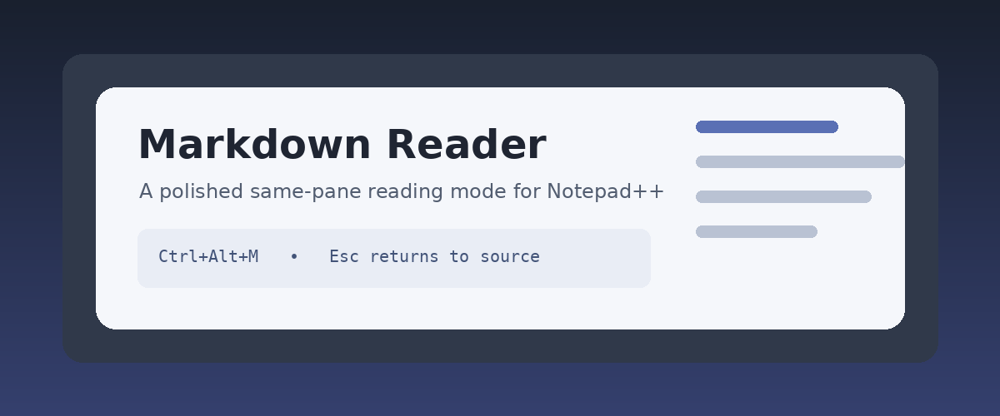

# Markdown Reader Demo

> A compact fixture for testing the same-pane Notepad++ reader.



## Overview

This document exercises common Markdown without relying on raw HTML or remote resources. It includes **strong text**, *emphasis*, ~~removed text~~, `inline code`, and a [local section link](#implementation-checklist).

### Why same-pane reading?

The source remains in Scintilla, but Reader Mode presents a calm layout with comfortable typography, responsive tables, code controls, and a generated outline.

## Implementation checklist

- [x] Main editor overlay
- [x] Secondary editor overlay
- [x] Light and dark themes
- [x] Local image handling
- [x] Live refresh
- [x] PDF export
- [ ] Click rendered paragraph to edit source

## Feature table

| Capability | Default | Notes |
|---|---:|---|
| Raw HTML | Blocked | Prevents document-provided scripts and active markup |
| Local images | Allowed | Must stay inside the document directory tree |
| Remote images | Blocked | Explicit privacy opt-in required |
| External links | Allowed | Opened by Windows outside the embedded reader |

## Code sample

```cpp
struct ReaderState {
    bool enabled = false;
    double scrollRatio = 0.0;
};
```

```powershell
cmake --preset vs2022-x64
cmake --build --preset release-x64
ctest --preset release-x64
```

## Longer reading section

A reader should preserve the strengths of Notepad++ rather than replacing them. The editor continues to own the file, undo history, encoding, backups, and plugin interoperability. The reading surface is disposable: hiding it immediately reveals the original source without transforming or duplicating the document.

### Local navigation

[Open the project README](../README.md).

### Final note

Press `Esc` to return to source editing.
